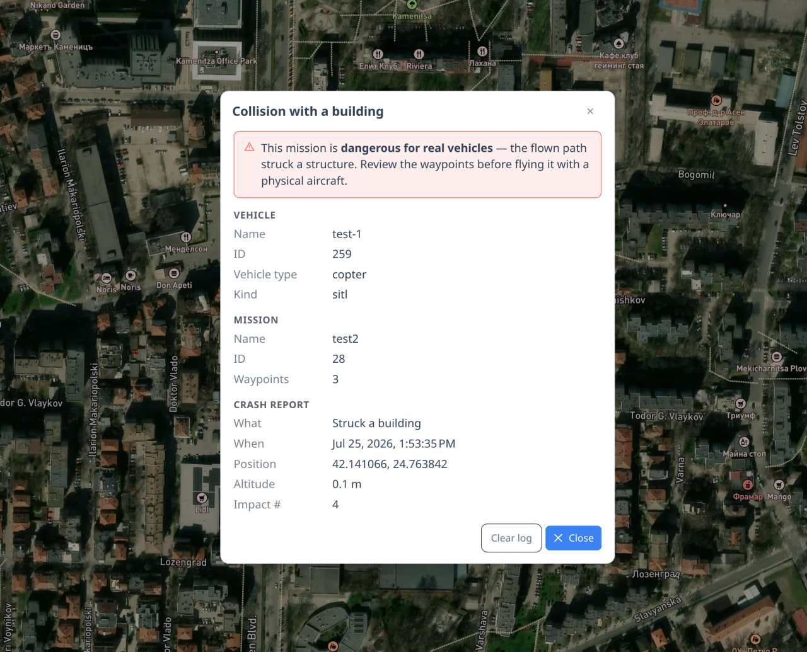
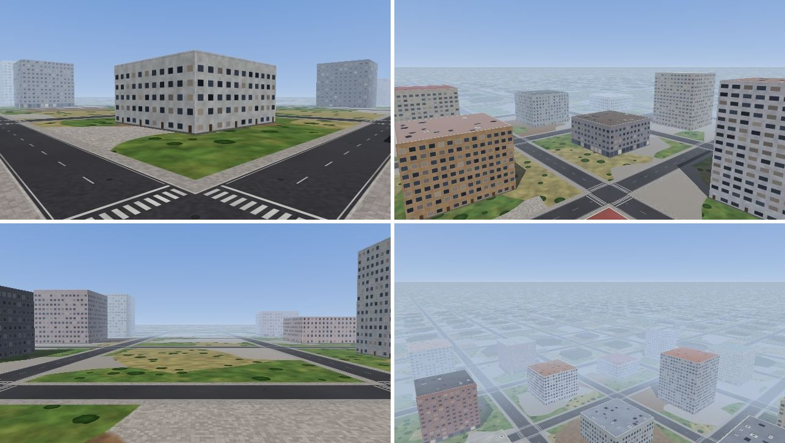
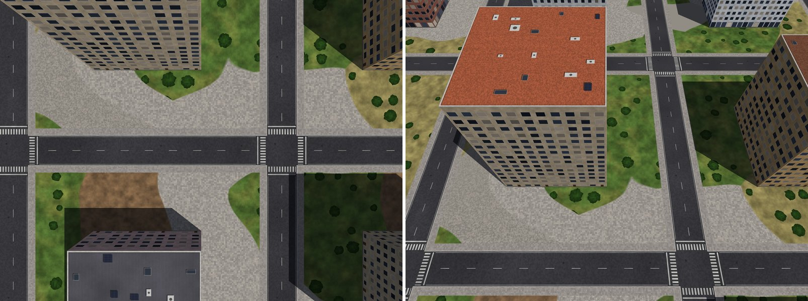
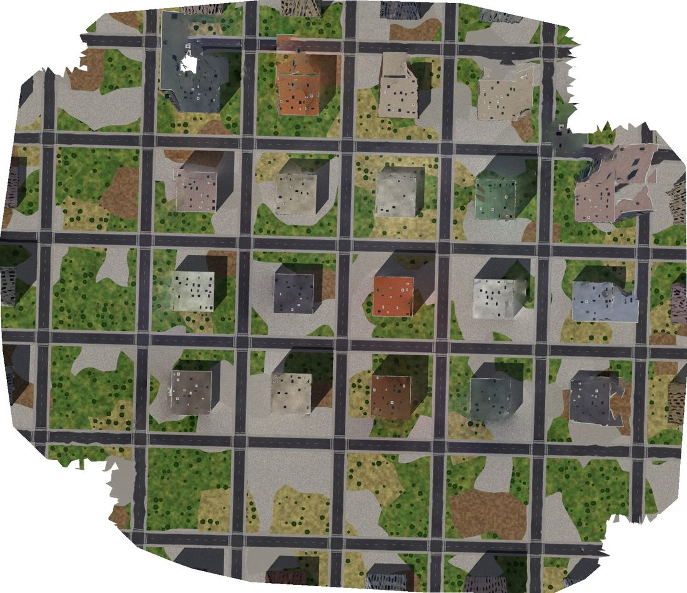
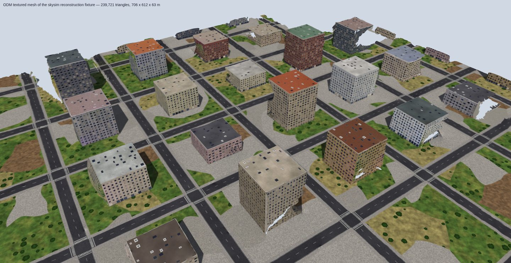

<h1 align="center">skysim</h1>

<p align="center">
  <a href="https://skyhub.ai"></a>
</p>

<p align="center"><sub><em>SkyHub turns a skysim building strike into a vehicle- and mission-specific safety report before the route reaches a real aircraft.</em></sub></p>

<p align="center">
  <strong>Fly hundreds of drones in one shared physics world — on a single CPU core.</strong><br/>
  A headless multi-vehicle flight simulator for <a href="https://ardupilot.org/">ArduPilot</a> SITL, built on
  <a href="https://github.com/jrouwe/JoltPhysics">Jolt Physics</a>. Gazebo's job, minus Gazebo.
</p>

<p align="center">
  <a href="https://skyhub.ai"></a>
  <a href="https://idrobots.com"></a>
  <a href="https://github.com/ID-Robots/skysim/actions/workflows/ci.yml"></a>
  
</p>

<p align="center">
  
  
  
  
</p>

---

## What is skysim?

skysim is a **drone swarm simulator**: a headless physics server that many unmodified
`arducopter` processes connect to over UDP, so an entire fleet flies in **one shared world**
where the aircraft can actually see and hit each other — and hit buildings.

It exists because the usual answer, Gazebo, is heavy for this shape of problem. skysim is
scoped to one job: **many quadcopters over a large scanned-city mesh**, with runtime
spawn/despawn, lockstep determinism when you want reproducibility, and wall-clock realtime
when operators are in the loop.

Vehicles are real, unmodified ArduPilot binaries speaking plain MAVLink, so a ground control
station — [SkyHub](https://skyhub.ai), Mission Planner, QGroundControl — connects to the
simulated fleet exactly as it would to real aircraft.

### Why it's built this way

| | |
|---|---|
| 🌍 **One world, many vehicles** | Every drone shares a single Jolt world, so **drone-vs-drone and drone-vs-building collisions are real physics**, not scripted events |
| ⚡ **~200 quads @ 800 Hz** | On a *single* physics core, with ~5× realtime headroom |
| 🎯 **Deterministic when you need it** | Strict lockstep mode: same inputs → byte-identical truth logs. Interactive mode ticks the wall clock and freezes stragglers instead of stalling the fleet |
| 🏙️ **Real city geometry** | Building meshes cooked offline into Jolt shapes, streamed in and out by vehicle proximity under a hard residency cap |
| 🔌 **Unmodified ArduPilot** | No forks, no patches — `arducopter --model json` and plain MAVLink |
| 🧩 **Runtime spawn/despawn** | REST control plane; add and remove aircraft while the world runs |
| 🪶 **Headless & cheap** | No renderer, no ROS, no Gazebo. One binary |

---

## How it works

Each `arducopter` outsources physics over UDP: it sends a servo packet (16 PWM values) to
`9002 + 10·I` and blocks until skysim replies. skysim turns PWM into motor thrust (spin-up
lag, X-quad mixer verified against the pinned ArduPilot source), steps one shared Jolt world
by a fixed dt, and replies with the truth state — IMU specific force, position, velocity,
attitude, optional rangefinder raycasts — as one JSON line whose timestamp **is** ArduPilot's
clock.

```
┌──────────────┐  servo PWM ──▶ ┌─────────────────────────────┐
│ arducopter 0 │ ◀── truth JSON │   skysim                    │
├──────────────┤                │                             │ ◀── REST :8642
│ arducopter 1 │ ◀────────────▶ │   one Jolt world, fixed dt  │     spawn / despawn
├──────────────┤                │   streamed city tiles       │     crash counters
│      ...     │ ◀────────────▶ │                             │     metrics
└──────────────┘                └─────────────────────────────┘
       │ MAVLink
       ▼
  SkyHub / QGroundControl / Mission Planner
```

Read in depth: [`docs/PROTOCOL.md`](docs/PROTOCOL.md) → [`docs/DESIGN.md`](docs/DESIGN.md) →
[`docs/SKYHUB_INTEGRATION.md`](docs/SKYHUB_INTEGRATION.md).

---

## Getting started

One command. It builds skysim, cooks a 1.2 km demo city, and renders it from four camera
poses — the same rasteriser that feeds a vehicle's camera stream in flight, so what you
get is what a drone would see:

```bash
tools/getting_started.sh
```



Images land in `build/getting_started/`. Needs the build tools, Python 3, and — on a
clean checkout — network access, because CMake fetches JoltPhysics, cpp-httplib, stb and x264
(install `nasm` too, or x264 is built without its assembly and encodes several times slower).
It does **not** need ArduPilot or a running simulator, which is the point: you can see
the thing work before committing to the half hour the autopilot build takes.

Once you do have ArduPilot (see below), the same script will fly a vehicle through that
city and serve its camera live:

```bash
ARDUPILOT_ROOT=~/ardupilot tools/getting_started.sh --fly
# then open http://127.0.0.1:8642/instances/0/camera.mjpg
# or, as H.264 the way a real camera streams it: ffplay rtsp://127.0.0.1:8554/instances/0/main.264
```

## Quick start

**Prerequisites** — Ubuntu 22.04/24.04, CMake ≥ 3.24, Ninja, GCC 12+ or Clang 16+, and an
ArduPilot checkout built for SITL:

```bash
git clone --recurse-submodules https://github.com/ArduPilot/ardupilot ~/ardupilot
cd ~/ardupilot && git checkout Copter-4.7.0 && git submodule update --init --recursive
./waf configure --board sitl && ./waf copter
export ARDUPILOT_ROOT=~/ardupilot
```

Also: `pip install pymavlink` (harnesses), `gcovr` (coverage), `trimesh` (real-mesh pre-step).

**Build and test** — the test suite needs no SITL:

```bash
cmake -B build -G Ninja -DCMAKE_BUILD_TYPE=RelWithDebInfo
cmake --build build -j
ctest --test-dir build --output-on-failure   # all unit, happy-path, and performance suites
ctest --test-dir build -L unit               # fast C++ correctness tests
ctest --test-dir build -L happy-path         # real binary + lifecycle smoke tests
ctest --test-dir build -L performance        # 800 Hz and reply-path performance budgets
tools/coverage.sh                            # HTML/XML/JSON; gates lines, branches, functions
```

Pull requests into `main` must pass GCC and Clang unit tests, simulator happy paths,
performance budgets, and full `src/` coverage. The stable `CI required` check combines
those jobs so branch protection can block a merge if any one fails.

**Fly two drones over a city:**

```bash
# cook a demo map once
python3 tools/cooker/pretile.py build/demo_map_obj
./build/tile_cooker build/demo_map/tiles build/demo_map_obj/*.obj

./build/skysim \
  --vehicles 2 --base-instance 1 \        # endpoints on udp 9012, 9022
  --time-mode interactive \               # or: strict (CI/replays; barrier + abort)
  --tiles build/demo_map/tiles \          # streamed: --stream-radius / --stream-max
  --rangefinders 2 \                      # rng_1 down, rng_2 right
  --wind 4,1,0 --gust 1.5,2 --seed 42 \   # steady + seeded OU gusts
  --api-port 8642                         # REST control plane

# then, per vehicle:
$ARDUPILOT_ROOT/build/sitl/bin/arducopter --model json:127.0.0.1 -I 1 \
  --home 42.1403890,24.7645490,0,0 \
  --defaults $ARDUPILOT_ROOT/Tools/autotest/default_params/copter.parm,tools/harness/params/skysim.parm
```

### Build a world from real buildings

`tools/cooker/osm_buildings.py` pulls real footprints and heights from
[OpenStreetMap](https://www.openstreetmap.org/) (ODbL) and extrudes them into collision
geometry, georeferenced to a WGS84 anchor so the simulated city lines up with the map your
operators see:

```bash
python3 tools/cooker/osm_buildings.py build/city_obj \
  --lat 42.1403890 --lon 24.7645490 --radius 5000
./build/tile_cooker build/city/tiles --anchor 42.1403890,24.7645490,0 build/city_obj/*.obj
```

That produces ~19 000 buildings over a 5 km radius — a real city your fleet can crash into.

### Docker

```bash
docker build -t skysim .
docker run --rm -p 8642:8642 -p 9002-9202:9002-9202/udp \
  -v $(pwd)/build/city/tiles:/world:ro -e SKYSIM_TILES=/world skysim
```

`docker-entrypoint.sh` turns `SKYSIM_*` variables into flags: `SKYSIM_API_BIND`,
`SKYSIM_API_PORT`, `SKYSIM_VEHICLES`, `SKYSIM_TILES`, `SKYSIM_STREAM_RADIUS`,
`SKYSIM_STREAM_MAX`, `SKYSIM_DT`, `SKYSIM_TIME_MODE`, `SKYSIM_SPAWN_HOME`,
`SKYSIM_RADIO_SPEC`, `SKYSIM_STILL_CONCURRENCY`, `SKYSIM_TEXTURE_SEED`, `SKYSIM_DOCK_MARKERS`,
`SKYSIM_DOCK_MARKER_SIZE`, `SKYSIM_DOCK_INNER_SIZE`, `SKYSIM_DOCK_MARKERS_VISIBLE`, the camera's
(below; `SKYSIM_CAMERA_DRAW_SIZE`, `SKYSIM_CAMERA_LANDING_SIZE`, `_FPS`, `_BITRATE`, `_RADIUS`,
`_HEIGHT`, `SKYSIM_CAMERA_REST_FPS` and `SKYSIM_CAMERA_CACHE_MB` among them), and
`SKYSIM_EXTRA_ARGS` for anything not listed.

**Set `SKYSIM_TIME_MODE=interactive` on a long-lived server.** The default is `strict`,
which is what determinism and CI replays need — a barrier every tick, and an abort when
a vehicle misses it. A server that vehicles join and leave wants the abort replaced by
eviction, or one lagging aircraft takes the fleet down with it. Both modes barrier on
every connected vehicle's frame; what interactive adds is wall-clock pacing and a way
out, freezing and then despawning a vehicle that has gone quiet for `--straggler-timeout`
(default 2 s). Match `SKYSIM_DT` to the scheduler rate the vehicles are launched with,
too: in lockstep, physics faster than the autopilot's loop means most ticks miss their
deadline, and while that no longer corrupts the flight it does cost wall-clock pace.

**`SKYSIM_CAMERA_FPS` is the camera switch.** Without it no frames are rendered and
the camera endpoints serve nothing, whatever else is set. With it, `SKYSIM_CAMERA_SIZE`
(default `256x144`), `SKYSIM_CAMERA_QUALITY`, `SKYSIM_CAMERA_THREADS`,
`SKYSIM_CAMERA_FOV`, `SKYSIM_CAMERA_PITCH` and `SKYSIM_CAMERA_RANGE` apply.
A vehicle is only drawn while somebody is asking for its picture — an open `camera.mjpg` or
RTSP stream, or a `camera.jpg` within the last 3 s — so a camera nobody watches costs nothing, however
many vehicles there are, and a parked vehicle's frame is re-sent rather than redrawn.
`SKYSIM_CAMERA_THREADS` is the number of threads drawing a frame (at background priority);
by default it is the number of CPUs the container may use — its cgroup quota and affinity,
not the host's core count — at most 4. The ground a camera sees is computed once per texel of a
world-space cache shared by every vehicle (`SKYSIM_CAMERA_CACHE_MB`, default 512, `0` = off) and
read back after that: a textured 1920x1080 frame looking down is about 140 ms of CPU warm and
190 ms with its H.264 encode in a climbing flight (800-900 ms before TASK-2661), and a 640x360 one
about 17-19 ms (77-105) ([cost table](#what-the-camera-costs-task-2661)). `GET /metrics` reports what the camera
achieves (`camera.fps`, `camera.render_ms`, `camera.landing`, `camera.ground_cache_mb`) and the
log carries the same every 10 s while frames are drawn:

```bash
docker run --rm -p 8642:8642 -p 8554:8554 -p 9002-9202:9002-9202/udp \
  -v $(pwd)/build/city/tiles:/world:ro -e SKYSIM_TILES=/world \
  -e SKYSIM_CAMERA_FPS=10 -e SKYSIM_CAMERA_SIZE=256x144 skysim
# http://localhost:8642/instances/0/camera.mjpg
# rtsp://localhost:8554/instances/0/main.264  (ffplay -rtsp_transport tcp ...)
```

**The camera is also H.264 over RTSP** (TASK-2561), the way the SIYI ZR30 on Observer 1 serves
it: `rtsp://<host>:8554/instances/<n>/main.264`, Constrained Baseline (`profile-level-id
42e01f`), no B-frames, zerolatency, SPS/PPS on every IDR, 1200 kbit/s and an IDR every second
by default, at the camera's size and rate — what a browser or a Janus H.264 room takes without
transcoding. A stream is encoded only while somebody plays it, on encoder threads of its own
(`SKYSIM_VIDEO_THREADS`), never on the physics tick. `SKYSIM_RTSP_PORT` (default `8554`, `0` =
off) and `SKYSIM_RTSP_BIND` place the server; `POST /instances/<n>/camera/encoder` changes a
stream's bitrate, fps and keyframe interval live and `POST /instances/<n>/camera/keyframe` asks
for an IDR. `SKYSIM_CAMERA_MJPEG=0` retires `camera.mjpg` once nothing reads it. Details:
[docs/SKYHUB_INTEGRATION.md](docs/SKYHUB_INTEGRATION.md) ([S6]) and
[docs/PROTOCOL.md](docs/PROTOCOL.md#pilot-camera-video-rtsp--rtp-not-part-of-the-wire-protocol).

**Each vehicle's picture keeps one size; what changes is how it is drawn** (TASK-2661). Every
frame of a vehicle's camera — camera.jpg, camera.mjpg, the RTSP stream (H.264 crops an odd width or
height down to even, at the right and bottom, so the intrinsics' cx and cy hold), the intrinsics —
has the same picture size, the fleet's `SKYSIM_CAMERA_SIZE` or the vehicle's own (set at spawn,
`POST /vehicles {"instance":3,"camera":{"size":"1280x720"}}`): OpenCV's FFmpeg capture, for one,
does not follow a stream whose picture changes size (it keeps returning the last frame of the old
size). A vehicle draws that picture in one of three modes:

- **normal**: drawn at `SKYSIM_CAMERA_DRAW_SIZE` (default the picture size) and scaled up to the
  picture, at `SKYSIM_CAMERA_FPS`;
- **landing**: while it is in the air within `SKYSIM_CAMERA_LANDING_RADIUS` (default 25 m) of its
  dock and at most `SKYSIM_CAMERA_LANDING_HEIGHT` (40 m) above the ground — where skyhub_core's
  ArUco precision landing, which takes over at 30 m within 15 m of home, reads the dock marker —
  drawn at `SKYSIM_CAMERA_LANDING_SIZE` (default the picture size: every pixel) at
  `SKYSIM_CAMERA_LANDING_FPS`, its stream at `SKYSIM_CAMERA_LANDING_BITRATE` kbit/s. On when either
  of the last three is set. Leaving takes 5 m more of either; a hover more than 0.12 m up, however still, keeps it;
- **at rest**: a vehicle that has not moved (2 cm, half a degree) for 5 s on the ground — parked on
  its dock — is drawn in its normal mode at `SKYSIM_CAMERA_REST_FPS` (default `0`: its mode's rate).
  Its picture does not change, so this only saves re-sending and re-encoding it; its stream keeps
  its frame rate. A vehicle spawned on its dock starts at rest. "On the ground" is a height, not a
  contact: its centre within 0.12 m of the ground plane (a quad resting there has it 0.07 m up), so
  a hover held that low and that still for 5 s counts as at rest too.

A mode keeps the picture's aspect ratio. Each vehicle is drawn on its own schedule, so a landing
drawn at 1920x1080@15 and a fleet drawn at 640x360@30 share the render threads without one
pacing the others. A vehicle's own settings, at spawn (`POST /vehicles` `"camera"`) or at any time
(`POST /instances/3/camera {"fps":10,"draw":"960x540"}`; `DELETE` puts the fleet's back), are in the
[control plane table](#control-plane---api-port). For dock precision landing on dev:

```bash
SKYSIM_CAMERA_FPS=15 SKYSIM_CAMERA_SIZE=1920x1080 SKYSIM_CAMERA_DRAW_SIZE=640x360 SKYSIM_CAMERA_FOV=81 \
SKYSIM_CAMERA_LANDING_FPS=15 SKYSIM_CAMERA_LANDING_BITRATE=4000 SKYSIM_CAMERA_REST_FPS=2 \
SKYSIM_CAMERA_THREADS=8   # every CPU of an 8-vCPU task, at background priority
```

What a consumer has to accept, and what that costs:
[docs/SKYHUB_INTEGRATION.md](docs/SKYHUB_INTEGRATION.md) ([S8]),
[What the camera costs](#what-the-camera-costs-task-2661).

**The camera follows the vehicle's gimbal** when the vehicle drives one (TASK-2548): ArduPilot's
mount pitch and yaw on servo outputs `SKYSIM_GIMBAL_PITCH_CHANNEL` (default 10, pitch -90..20
degrees) and `SKYSIM_GIMBAL_YAW_CHANNEL` (default 11, yaw -180..180), both over 1100..1900 us —
the BrushlessPWM mount (`MNT1_TYPE 7`) the SkyHub gateway builds every SITL with. The pilot
camera then looks along the heading plus the gimbal's yaw at the gimbal's pitch, stabilised;
a vehicle with no pulse on that output keeps the fixed `SKYSIM_CAMERA_PITCH`, rigidly mounted.
`SKYSIM_GIMBAL_PITCH_CHANNEL=0` never follows a gimbal.

**Every vehicle's dock carries Observer 1's e-ArUco marker** (TASK-2562): DICT_7X7_250 ID 228
at 1.00 m with ID 11 at 0.09 m nested in its centre cell, from skyhub_core's generator
(`assets/markers/`). It lies flat on the ground at the vehicle's home, heading north, and both
cameras draw it at its real size, so a SITL can land on it with the unmodified aruco_landing
module. `GET /instances/<n>/camera/intrinsics` publishes the pinhole the camera renders with (fx,
fy, cx, cy, no distortion) and the `picture_revision` it is for. `GET /instances/<n>/camera/dock` gives the marker's ground truth
(pose, lat/lon, both markers' corners, the vehicle's offset from it); `POST` moves it and `DELETE`
puts it back. `SKYSIM_DOCK_MARKERS=0` turns it off, and `SKYSIM_DOCK_MARKER_SIZE` /
`SKYSIM_DOCK_INNER_SIZE` set the sizes. A vehicle's own cameras (pilot camera, RTSP, stills) draw
its own dock alone, so its picture never holds a neighbour's identical marker (TASK-2609);
`SKYSIM_DOCK_MARKERS_VISIBLE=all` draws every dock in every camera (default `own`). The marker
costs nothing until a camera has one in shot.
Details, the cv2.aruco proof from 30 m to 0.7 m and what it found:
[docs/DOCK_MARKER.md](docs/DOCK_MARKER.md).

**Survey stills need no switch.** `GET /instances/<n>/still.jpg` renders one large, exactly
posed frame on demand, whatever `SKYSIM_CAMERA_FPS` says, so it costs nothing until it is
asked for. `SKYSIM_STILL_CONCURRENCY` (default `2`; `0` turns the route off) caps renders in
flight, and `SKYSIM_TEXTURE_SEED` (default `1`) picks the world's texture for stills and the
camera feed alike — see [Survey stills](#survey-stills-and-the-reconstruction-fixture).

---

## Control plane (`--api-port`)

| Endpoint | Effect |
|----------|--------|
| `POST /vehicles` `{"instance":N, "launch_process":true}` (both fields optional) | reserve a requested or next-free ArduPilot instance (optionally forks arducopter) → `{id, instance, json_port, mavlink_tcp}` |
| `DELETE /vehicles/{id}` | despawn, release instance, kill managed process |
| `GET /vehicles` | per-vehicle: connected, frozen, silent_ticks, pos_ned, `midair_collisions`, `building_contacts`; `radio` when a radio field is set |
| `GET /metrics` | tick p50/p99 µs, straggler_events, freezes, resident_tiles; `camera` (`null` when off): `target_fps`, achieved `fps` per watched vehicle, `watched`, `render_ms` / `render_ms_max` / `encode_ms` per frame, `threads`, `frames_drawn`, `frames_reused`, `landing` (vehicles on the landing camera), `ground_cache_mb` / `ground_cache_budget_mb` / `ground_tiles_built`; `video` (`null` when RTSP is off): `rtsp_port`, `streams`, `clients`, `threads`, `encode_ms`, `frames_encoded`, `frames_dropped`, `keyframes`, `bytes_sent` |
| `POST /mission/check` `{"waypoints_ned":[[n,e,d],...], "clearance_m":1.0}` | sweep a planned route through loaded building geometry → `{checked, clear, hits}` |
| `PUT` / `GET` / `DELETE /radio` | set, read or clear the simulated 4G radio field (carriers, towers, coverage holes) |
| `GET /radio/sample?lat&lon&alt_amsl` | RSRP / RSRQ / SINR / RSSI, serving cell and link quality per carrier at a point |
| `GET /radio/grid?bbox&alt_rel&step_m&carrier` | the same as a ground-truth raster over an area (≤ 250 000 cells) |
| `GET /instances/{n}/still.jpg`, `GET /vehicles/{id}/still.jpg` | one survey still, rendered on demand from the vehicle's pose; query `w h hfov pitch yaw roll_stab range q`, pose in `X-Skysim-*` headers |
| `GET /instances/{n}/camera.jpg` / `.mjpg` (and by `/vehicles/{id}`) | the pilot camera feed (`--camera-fps`); `.mjpg` off with `--camera-mjpeg 0`. Each JPEG (and each `.mjpg` part) names the picture revision it was drawn for in `X-Skysim-Picture-Revision`: the number `picture.revision` of `GET .../camera` and `picture_revision` of `GET .../camera/intrinsics` name while they describe that picture. A size change (`POST .../camera`) makes a new revision, and no frame of the old size is served after it — but a frame and a calibration read in two requests can straddle one, so a reader that needs the pair compares the two numbers |
| `GET` / `POST` / `DELETE /instances/{n}/camera` (and by `/vehicles/{id}`) | the vehicle's camera (TASK-2661): `picture` (`width`, `height`, `own`, `revision`: how many times its size has changed), `now` (`mode` normal or landing, `resting`, `draw_width`, `draw_height`, `fps`, `bitrate_kbps`), `normal` and `landing` (the same fields; `own`, and for landing `available`, `enabled`, `active`, `radius_m`, `height_m`), `rest_fps`, `watched`, `achieved_fps`, `render_ms`; a landing mode that is not available has its draw size, `fps` and `bitrate_kbps` null (POSTing a GET back leaves nulls alone). POST: `width`/`height` (or `"size":"WxH"`) set its picture size — best at spawn, it is what a reader's stream changes to; `draw_width`/`draw_height` (or `"draw":"WxH"`), `fps`, `bitrate_kbps` its normal mode (also inside `"normal":{}`); `"landing":{...}` its own landing mode; `"landing":false/true` turns that off or on. Out of bounds (16..3840 x 16..2160, 1..60 fps, 0 or 64..8000 kbps), or a draw size of another aspect ratio than the picture's (one rule, here and for `--camera-draw-size`: width over height within 1 % of the picture's, or the height within half a pixel of the picture's share of the width), or one side given alone whose other side — the picture's aspect ratio of it — falls outside those bounds (a draw width of 3840 for a 16x2160 picture), is `400` and changes nothing. A draw size that is only the one the vehicle already draws at by inheritance (the picture's, or the fleet's) is not a setting, so a GET's answer can be POSTed back with one field changed and the vehicle still follows its picture; a different one is the vehicle's own. DELETE: the fleet's settings again. Unlike spawn and despawn these take effect on the camera's next frame, not at a tick boundary (the camera is not world state). `POST /vehicles` takes the same object as `"camera"` (and a bad one spawns nothing — with the pilot camera on; without `--camera-fps` the pilot camera is off and the `camera` member is ignored, whatever it holds, as the spawn ignores it). `instance`, `launch_process` and the battery members of a spawn are read from the top level of the body, never from inside `"camera"` |
| `GET` / `POST /instances/{n}/camera/encoder` `{"bitrate_kbps","fps","keyframe_interval_s"}` | the H.264 encoder behind `rtsp://<host>:8554/instances/{n}/main.264`; POST answers with the values applied (clamped) |
| `POST /instances/{n}/camera/keyframe` | the stream's next frame is an IDR |

All mutations execute at tick boundaries; reads come from per-tick snapshots. The SkyHub
gateway polls `GET /vehicles` and, on a collision-counter increase, emits a crash alert to
the dashboard.

The radio field is a deterministic LTE model — path loss that eases with altitude, sector
and vertical antenna patterns, correlated shadowing, coverage holes, same-carrier
interference — for developing network-quality surveys in simulation. Model, spec format and
API: [`docs/RADIO.md`](docs/RADIO.md).

## Survey stills and the reconstruction fixture

A simulated mapping mission needs photos that photogrammetry can reconstruct, so skysim has a
survey still camera beside the small pilot feed:



```bash
curl -o frame.jpg -D - "http://127.0.0.1:8642/instances/0/still.jpg?w=1600&h=1200&pitch=-90"
# X-Skysim-Time-Usec, X-Skysim-Lat, X-Skysim-Lon, X-Skysim-Alt-Amsl, X-Skysim-Alt-Rel,
# X-Skysim-Yaw, X-Skysim-Pitch, X-Skysim-Roll (camera axes, degrees), X-Skysim-Hfov,
# X-Skysim-Gimbal (1 when the angles are the vehicle's gimbal's)
```

| Query | Default | Range | Meaning |
|---|---|---|---|
| `w`, `h` | 1600, 1200 | 64..4096 | frame size, pixels |
| `hfov` | 73.7 | 10..120 | horizontal field of view, degrees (73.7 = a 24 mm-equivalent lens) |
| `pitch` | -90 | -90..0 | camera pitch, degrees; -90 is straight down |
| `yaw` | 0 | -360..360 | camera yaw relative to the vehicle's heading, degrees |
| `roll_stab` | 1 | 0, 1 | 1: gimbal-stabilised, airframe roll and pitch do not tilt the camera; 0: rigid mount |
| `gimbal` | 0 | 0, 1 | 1: where the vehicle's gimbal points (its pitch, heading + its yaw, stabilised); `pitch`, `yaw` and `roll_stab` then apply only to a vehicle without one |
| `range` | 600 | 50..3000 | draw distance for buildings, metres |
| `q` | 90 | 1..100 | JPEG quality |

The frame is drawn from one consistent snapshot of the vehicle's pose (position, attitude and
sim time from the same tick), on background-priority worker threads, and never waits on or
slows the physics tick. At most `SKYSIM_STILL_CONCURRENCY` render at once; past that the
answer is `503` with `Retry-After: 1`. Every input is bounded and every error is JSON. Lat/lon
come from `--spawn-home` by ArduPilot's own flat-earth conversion, so they match the GPS the
autopilot reports (if `--spawn-home` is not `lat,lon[,alt,yaw]` they are left out and an
`X-Skysim-Warning` header says so).

The world is textured for structure from motion: roads with lane markings, crossings and
manholes, kerbs and paved sidewalks, patches of grass, dry grass, gravel, soil and paving with
shrubs, and per-building wall and roof materials and colours, windows, plinths, cornices,
parapets and rooftop plant, with detail down to about a centimetre. All of it is a pure
function of the world position and `--texture-seed` — the same point has the same colour in
every photo of it — filtered to each pixel's footprint like a real lens, lit by a sun to the
south-west, with cast shadows. Where no tile is loaded the ground still renders. The pilot
camera uses the same scene and shading.

`tools/survey/survey_fixture.py` flies a virtual camera over the demo city on a survey grid
without ArduPilot and writes frames with EXIF GPS plus an OpenDroneMap `geo.txt` — the
reconstruction fixture:

```bash
cmake --build build --target survey_still tile_cooker
# 300 x 200 m block, 100 m up, 80/70 % overlap, nadir plus a crosshatch at -60 (338 frames):
tools/survey/survey_fixture.py --out build/odm/images --crosshatch -60
docker run --rm -v $(pwd)/build:/datasets opendronemap/odm --project-path /datasets odm \
  --geo /datasets/odm/images/geo.txt
```

Reconstructed with OpenDroneMap 3.6 (orthophoto, 10 cm; textured mesh):




The frames hold up to the geometry: ODM's own structure from motion puts the nadir grid plus
either oblique grid within 1-6 cm of the geotags, the cameras within 0.01 degrees of their true
pointing, and self-calibrates the focal length to the exact one. One caveat, about ODM rather
than the frames: on the full nadir + crosshatch set its default incremental SfM can bootstrap
from two obliques that see almost only flat ground (the demo city is ~84 % ground), and a
plane-based start has two valid solutions — it took the wrong one and the model diverged. The
images above come from the two cm-accurate partial models merged, all tracks triangulated with
`opensfm reconstruct_from_prior`, then ODM's dense, mesh, texture and orthophoto stages as
usual. Do not feed ODM camera angles in `geo.txt` for `--sfm-algorithm triangulation`: ODM 3.6
converts them through a frame that is not local level away from the equator.

A 1600x1200 nadir frame of the demo city renders in about 0.55 s on one core, 0.27 s on the
two threads a still gets by default, and 0.15–0.2 s on four (Ryzen 7 5700X), plus ~40 ms of
JPEG encode.

## Useful flags

| Flag | What it does |
|---|---|
| `--truth-log out.csv` | Ground truth per tick — judge the physics with this, not the EKF |
| `--record-servo` / `--replay-servo` | Deterministic input tapes for reproducible runs |
| `--time-mode strict` | Lockstep barrier on every vehicle; aborts on a straggler (CI) |
| `--straggler-timeout <seconds>` | interactive: silence before a vehicle is frozen out of the barrier (2 s) |
| `--stream-radius` / `--stream-max` | City tile residency around each vehicle |
| `--physics-threads` | Opt a single huge world into Jolt's thread pool (only worth it past ~1000 bodies) |
| `--io-threads` | Fan the reply path across cores (helps past ~48 vehicles) |
| `--canned` | M1 protocol-debug mode |
| `--radio-spec field.json` | Start with a simulated radio field ([`docs/RADIO.md`](docs/RADIO.md)); `PUT /radio` can replace it |
| `--still-concurrency N` | Survey stills rendering at once (2; 0 = still route off); more get `503` + `Retry-After` |
| `--still-threads N` | Background-priority worker threads per still render (2) |
| `--texture-seed N` | Seed of the world's procedural texture (1): same seed, same world, every run |

Live acceptance harnesses (need `ARDUPILOT_ROOT`; use `--base-instance 1`+ if something
already owns the instance-0 SITL ports):

```bash
python3 tools/harness/conformance.py --base-instance 1 [--vehicles 10]   # mission gate
python3 tools/harness/churn.py --sim ./build/skysim                      # spawn/despawn 100×
PYTHONPATH=tools/harness python3 tools/harness/determinism.py --base-instance 1
PYTHONPATH=tools/harness python3 tools/harness/collision_demo.py --base-instance 1
```

## Performance

One world sustains **~200 quads at 800 Hz on a single physics core with ~5× realtime
headroom**; scale past that by sharding worlds across processes. Four optimizations got it
there: a single-threaded physics job system by default (Jolt's thread jitter is a net loss
below ~1000 bodies), an integer fixed-precision JSON formatter (6.3× faster than
`snprintf`), O(1) contact attribution, and a reply path that fans across `--io-threads`
cores above 48 vehicles. Measured tick breakdown in [`docs/DESIGN.md`](docs/DESIGN.md).

The performance suite fails if a 200-vehicle world misses its 1,250 µs tick budget, if the
protocol hot path exceeds 2,000 ns per vehicle, or if the pooled 100-vehicle reply path
misses the same 1,250 µs budget.

### What the camera costs (TASK-2661)

`tools/bench/camera_cost.py` runs skysim per camera setting and fleet size with a stand-in SITL
and one RTSP reader per vehicle (what skyhub_core's camera input is), and measures skysim's CPU
from `/proc`. Every vehicle climbs off its dock with its gimbal at -90 degrees: all ground, the
costliest thing to draw, and a cold ground cache at every halving of its height. Measured on a
Ryzen 7 5700X with skysim pinned to 4 cores (`--cpus 0-3`, 4 render and 2 encoder threads), on a
pretile city of 400 buildings (`pretile.py --extent 1000`). *CPU-ms/frame* is the camera's CPU per
frame delivered (render, scale, H.264); *cores for target* is that times the target rate and the
fleet: the CPUs the setting needs. *fps each* is what each reader got from the 4 cores — the box
was shared with a desktop (load 5-7), and the render threads run at nice +10, so a frame rate
below target here is CPU the box did not give, not CPU skysim lacked. Before = `cec2ac9`.

| camera | vehicles | before: fps each | before: render ms | before: CPU-ms/frame | before: cores used | before: cores for target | after: fps each | after: render ms | after: CPU-ms/frame | after: cores used | after: cores for target |
|---|---|---|---|---|---|---|---|---|---|---|---|
| 640x360@30 | 1 | 17.0 | 50.0 | 105.0 | 1.78 | 3.15 | 30.0 | 4.6 | 19.3 | 0.58 | 0.58 |
| 640x360@30 | 4 | 8.16 | 29.9 | 88.5 | 2.89 | 10.62 | 30.0 | 4.5 | 17.5 | 2.1 | 2.1 |
| 640x360@30 | 8 | 4.27 | 36.5 | 76.9 | 2.62 | 18.46 | 25.34 | 4.8 | 16.9 | 3.43 | 4.06 |
| 1280x720@30 | 1 | 5.75 | 157.5 | 369.9 | 2.13 | 11.1 | 30.0 | 18.2 | 72.6 | 2.18 | 2.18 |
| 1280x720@30 | 4 | 1.72 | 153.3 | 312.5 | 2.15 | 37.51 | 11.53 | 20.0 | 72.9 | 3.36 | 8.75 |
| 1280x720@30 | 8 | 0.89 | 137.5 | 299.4 | 2.13 | 71.85 | 5.94 | 18.4 | 72.0 | 3.42 | 17.29 |
| 1920x1080@10 | 1 | 2.75 | 344.5 | 788.8 | 2.17 | 7.89 | 10.0 | 59.7 | 209.5 | 2.09 | 2.1 |
| 1920x1080@10 | 4 | 0.78 | 341.9 | 713.9 | 2.23 | 28.55 | 4.97 | 49.1 | 180.6 | 3.59 | 7.22 |
| 1920x1080@10 | 8 | 0.53 | 217.3 | 736.2 | 3.13 | 58.89 | 2.34 | 53.3 | 189.0 | 3.54 | 15.12 |
| 1920x1080@15 | 1 | 2.75 | 372.4 | 772.9 | 2.13 | 11.59 | 14.87 | 55.2 | 191.5 | 2.85 | 2.87 |
| 1920x1080@15 | 4 | 0.78 | 312.5 | 715.6 | 2.24 | 42.94 | 5.03 | 50.6 | 178.2 | 3.59 | 10.69 |
| 1920x1080@15 | 8 | 0.39 | 326.6 | 717.2 | 2.24 | 86.06 | 2.3 | 47.8 | 196.4 | 3.61 | 23.57 |
| 1920x1080@30 | 1 | 2.25 | 376.1 | 907.8 | 2.04 | 27.23 | 17.62 | 55.9 | 190.0 | 3.35 | 5.7 |
| 1920x1080@30 | 4 | 0.66 | 405.1 | 840.5 | 2.21 | 100.86 | 4.91 | 51.0 | 179.8 | 3.53 | 21.57 |
| 1920x1080@30 | 8 | 0.41 | 287.2 | 698.8 | 2.27 | 167.72 | 1.98 | 60.6 | 210.7 | 3.34 | 50.56 |

Three changes make the difference: the lit ground is read from a world-space cache instead of
computed per pixel (the procedural ground texture was three quarters of a frame), the tiles a frame
needs are built across every render thread before it is drawn, and bands are handed out as threads
come free. Per frame that is 4-5x less CPU at every size.

With a picture kept at 1920x1080 and drawn as `SKYSIM_CAMERA_DRAW_SIZE=640x360`,
`SKYSIM_CAMERA_LANDING_FPS=15`, `SKYSIM_CAMERA_LANDING_BITRATE=4000`, `SKYSIM_CAMERA_REST_FPS=2`
(the settings recommended for dev), eight vehicles on the same 4 cores:

| fleet | normal fps | camera cores used | CPU-ms per frame | note |
|---|---|---|---|---|
| 8 parked, read over RTSP | 30 | 0.18 | 11 | 2 fps each (the rest rate); before: 2.0 cores at 1920x1080, 0.43 at 640x360 |
| 8 flying, normal mode | 30 | 3.66 (all of them) | 46 | 9.9 fps each of 30: needs 11 cores |
| 8 flying, normal mode | 15 | 3.58 (all of them) | 52 | 8.7 fps each of 15: needs 6.2 cores |
| 1 landing, 7 flying | 15 | 3.59 (all of them) | 72 | |
| 2 landing, 6 flying | 15 | 3.53 (all of them) | 104 | |
| 1 landing, 3 flying, 4 parked | 15 | 3.0 | 107 | |

Per vehicle, then, in cores of this machine: **parked and read** 0.02 (at 2 fps); **flying, normal
mode** 0.05 per fps (a 640x360 drawing, scaled, and a 1920x1080 H.264 encode of about 17 ms);
**landing** 0.19 per fps (a 1920x1080 drawing, about 140 ms of CPU warm and up to 190 while it
climbs or descends through new ground-cache levels). Physics and the SITL lockstep add about 0.2
for a handful of vehicles. One Fargate vCPU (a hyperthread of a 2.5-3.5 GHz Xeon or EPYC) is
assumed to do about half of what a core here does — an estimate, not a measurement: read
`GET /metrics` `camera` and the task's CPU on dev after a landing to check it.

## Project status

Milestones M0–M6 are complete: protocol layer, single-quad flight conformance, wind /
rangefinders / determinism, multi-vehicle lifecycle, city tiles & streaming, and scale +
SkyHub integration. CI measures every first-party simulator source under `src/` and gates
at **85% lines, 70% branches, and 95% functions**. Detailed HTML, Cobertura XML, JSON, and
text reports are retained with each Actions run. History and acceptance evidence live in
[`docs/MILESTONES.md`](docs/MILESTONES.md).

Pending human sign-off on the flight model: `k_thrust=7.65e-6`, linear-only drag, and
`SIM_RATE_HZ=800` + `--dt 1/800` for conformance (ArduPilot pre-arm requires a gyro rate
≥ 1.8× the loop rate).

## Repo map

```
src/protocol/   servo packet ABI + state JSON emitter + UDP endpoints (no Jolt)
src/core/       frames.h (NED/FRD <-> Jolt), world.cpp (the ONLY Jolt-aware TU), metrics
src/vehicle/    motor lag + X-quad mixer + instance allocator / process manager
src/terrain/    OBJ -> MeshShape cooker + proximity tile streamer
src/api/        REST control plane (cpp-httplib)
src/radio/      simulated 4G radio field: spec validation + deterministic RSRP/SINR model
src/render/     threaded software rasteriser + JPEG/MJPEG camera feed per vehicle
tools/cooker/   pretile.py (demo city) + osm_buildings.py (real city) + tile_cooker CLI
tools/bench/    gated world, protocol, and UDP reply-path performance benchmarks; camera_cost.py
                (the camera's CPU by picture size, rate and fleet)
tools/harness/  conformance / determinism / straggler / churn / collision / corridor
tools/render_probe/  render one frame from a given camera pose, to a JPEG; --dock and --cache,
                aruco_check.py (cv2.aruco on probe pictures), stream_check.py (cv2.aruco through RTSP)
tools/survey/   survey_still (stills from poses, no simulator) + survey_fixture.py (ODM fixture)
tools/getting_started.sh  build + cook + render the demo city (see "Getting started")
tests/          unit tests + app_smoke.py driving the real binary
```

Notable interop findings baked into [`docs/PROTOCOL.md`](docs/PROTOCOL.md): ArduPilot's
`strstr` JSON parser rules (field ordering, compact booleans), the two-line handshake
(always reply, even to duplicates), and an upstream Copter-4.7.0 bug where rangefinder data
only flows when euler `attitude` accompanies the quaternion.

---

## Built for SkyHub

skysim gives **[SkyHub](https://skyhub.ai)** a shared digital-twin environment for
autonomous-drone operations. In the tested local integration, SkyHub-created SITL vehicles
keep the normal ArduPilot/MAVLink mission and telemetry path while outsourcing physics to
skysim. The gateway reserves each ArduPilot instance through the REST control plane, and
every vehicle joins the same georeferenced Jolt world.

That integration provides:

- **One fleet, one physical world.** Simulated vehicles can collide with one another and
  with streamed building geometry instead of running as isolated SITL sessions.
- **Live operator feedback.** `GET /vehicles` reports connection and freeze state,
  ground-truth position, and separate mid-air and building-collision counters. The SkyHub
  gateway turns counter increases into collision alerts in the dashboard.
- **Runtime fleet lifecycle.** SkyHub can reserve a specific instance with
  `POST /vehicles {"instance":N}` and remove it without stopping the shared world, keeping
  its allocator aligned with ArduPilot's port mapping.
- **Pre-flight geometry checks.** `POST /mission/check` can sweep planned NED mission legs
  with a configurable approximate clearance envelope through building geometry. It reports
  `checked:false` rather than incorrectly calling a route clear when geometry is unavailable.

The local path has been exercised end to end with two SkyHub-created drones, a physical
mid-air collision, and live dashboard alerts. The
[SkyHub integration notes](docs/SKYHUB_INTEGRATION.md) cover the architecture, test
evidence, and the remaining work to package the GCS heartbeat helper for deployment.

<p align="center">
  
</p>

<p align="center"><sub><em>A real mid-air collision in a shared skysim world, surfaced live in <a href="https://skyhub.ai">SkyHub</a>.</em></sub></p>

Made by **[ID Robots](https://idrobots.com)** — the team behind the Observer drone and the
NexusBox docking station.

[Jolt Physics]: https://github.com/jrouwe/JoltPhysics

## License

skysim is free software released under the **GNU General Public License v3.0 or later**
(GPL-3.0-or-later) — the same license as [ArduPilot], the autopilot it simulates.

See [LICENSE](LICENSE) for the full text.

You may use, study, modify and redistribute skysim. If you distribute a modified
version, or a work derived from it, that work must also be released under the GPL.

**Using skysim with proprietary software:** skysim runs as its own process and speaks
to the outside world only over the network — a REST control plane and UDP servo/state
packets (see `docs/PROTOCOL.md`). Software that merely talks to a skysim instance over
those interfaces is a separate program, not a derivative work, and is unaffected by
this license. Linking skysim's source or objects into another program is a different
matter and does place that program under the GPL.

[ArduPilot]: https://github.com/ArduPilot/ardupilot
